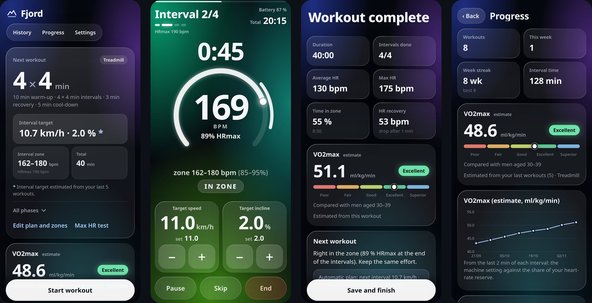

<h1 align="center">Fjord</h1>

  <b>Norwegian 4×4 interval training, guided by your heart rate.</b> 
  Put on a heart-rate strap, open Fjord on your phone, and train in the right zone every interval.

  <a href="https://lrazum.github.io/fjord/"><b>Open Fjord →</b></a>
  &nbsp;·&nbsp;
  <a href="https://revolut.me/lovrorazum">Support on Revolut</a>

  

## What is 4×4?

A short, hard workout that raises your fitness (VO2max):

| | |
|---|---|
| **Warm-up** | 10 min easy |
| **4 intervals** | 4 min each, hard: 85–95 % of your maximum heart rate |
| **Recovery** | 3 min easy between intervals |
| **Cool-down** | 5 min easy |

About 40 minutes in total, once or twice a week. The hard part is hitting the right intensity: too easy and you miss the benefit, too hard and you blow up by interval three. That is what Fjord is for.

## What Fjord does

- **Shows your zone at a glance.** A big heart-rate dial and a background that turns blue (too low), green (in the zone) or red (too high). You can read it mid-sprint.
- **Picks your interval speed for you.** Fjord learns from your past workouts what speed or level gets you into the zone, and checks your warm-up to fine-tune today's target.
- **Coaches you live (optional).** If you stay out of the zone, it suggests a small change: "speed up 0.5 km/h", "lower the incline".
- **Estimates your VO2max** after every workout and rates it for your age and sex, so you can see your fitness go up week by week.
- **Keeps your history.** Every workout with a heart-rate chart, time in zone, recovery heart rate and progress charts.
- **Finds your maximum heart rate.** Enter it, estimate it from your age, or do the built-in 23-minute test.
- **Works on any cardio machine:** treadmill, gym bike, stepmill, rowing machine, or outdoors running and cycling.
- **Stays out of your way.** Keeps the screen on, works offline, and picks up where you left off if the phone or app restarts mid-workout.
- **Exports** to Strava and Garmin Connect (TCX), CSV, or a full backup file.
- In **English** and **Croatian**.

## What you need

- **A phone.** iPhone or Android.
- **A Bluetooth heart-rate strap**, such as Polar H10, Garmin HRM, Wahoo TICKR or Coros. A watch also works if it can broadcast heart rate (Garmin, Coros, Polar, Suunto).
- **On iPhone: the free Bluefy browser** (*Bluefy – Web BLE Browser* on the App Store). Safari can't talk to Bluetooth devices; Bluefy can. On Android, Chrome works out of the box.

No strap yet? Choose **Simulator** on the home screen to try the whole app with a simulated heart rate.

## Get started

1. Open **[lrazum.github.io/fjord](https://lrazum.github.io/fjord/)** in Bluefy (iPhone) or Chrome (Android).
2. Answer a few setup questions: your maximum heart rate (or your age), and your strap.
3. Bookmark the page. On iPhone, turn on **Fullscreen** in the Bluefy menu for an app-like screen.
4. Wet the strap, put it on, tap **Connect strap**, choose your activity, and tap **Start workout**.

During the workout, use **+ / −** to tell Fjord what you set on the machine. That is how it learns your speeds.

## Your data stays on your phone

No account, no sign-up, no server, no tracking. Workouts are stored only in the browser on your phone.

That also means: **if you delete Bluefy or clear its website data, your history is gone.** Use *Settings → Your data → Export backup* now and then, and keep the file somewhere safe.

## Tips

- **The strap doesn't show up.** Most straps connect to one device at a time. Disconnect it from your watch or other apps first, and wet the electrodes.
- **The screen turns off during a workout.** Set *Settings → Display & Brightness → Auto-Lock → Never* on the iPhone for the session.
- **Music stops when the workout starts (iPhone).** Fjord keeps the screen awake with a silent video, which iOS can treat as media. Start your music again after the workout begins.
- **Getting the latest version.** Just reload the page. Fjord updates itself whenever it has a connection.
- **Bike or rower VO2max.** Add your weight in *Settings → Profile*.

## Support Fjord

Fjord is free, with no ads and no subscriptions. If it helps your training and you'd like to say thanks, you can send a tip on Revolut:

  

Ideas and bug reports are just as welcome: [open an issue](https://github.com/LRazum/fjord/issues).

## License

[MIT](LICENSE). Technical notes for running and changing the code are in [docs/DEVELOPMENT.md](docs/DEVELOPMENT.md).
